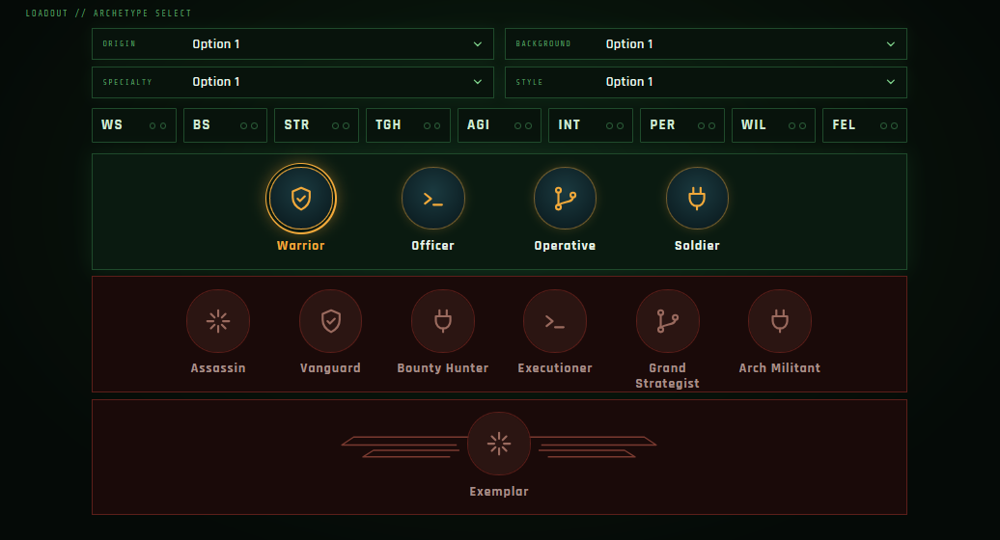
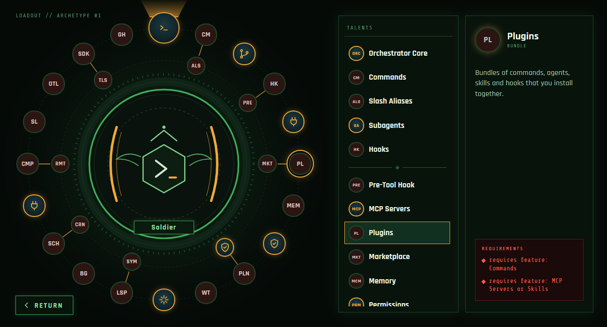

# UI Design

Brief description of the two screens. The mock-ups in [`design/`](../design) are **concepts**: they show the layout, not final names or icons.

What the user may pick is never decided here. Options come from the availability functions in [Availability Rules](./availability-rules.md), and every change goes through the validator ([Architecture §6](./Architecture.md#6-validation)). This document only covers how that is presented.

## Screens

| Screen                                         | Purpose                                                    |
| ---------------------------------------------- | ---------------------------------------------------------- |
| [Archetype pick](#archetype-pick-screen)       | Choose the static choices, starting increases, and the first archetype, second archetype and Exemplar |
| [Level-up](#level-up-screen)                   | Fill in one archetype's level progression                 |

Clicking an archetype, or the Exemplar, that can be picked selects it and opens its level-up screen. Clicking the selected one opens it without changing anything. **Return** goes back to the archetype pick screen. Which screen is open isn't part of the build, so it isn't in the URL: a reload opens the archetype pick screen.

Every edit on either screen follows the same path: `apply change → validate → store state → encode to URL` ([Architecture §6](./Architecture.md#6-validation)).

---

## Archetype pick screen

Top to bottom: the static choices, the starting characteristic increases, then the three archetype rows.

### Static choices

Four dropdowns, two per line: homeworld, origin, triumph and darkest hour. The labels in the mock-up are placeholders. There is no character dropdown, because the first version supports only the Rogue Trader ([Vision](./00-vision.md#first-version)). All four are built.

Every dropdown always offers its whole table: triumphs and darkest hours don't depend on the origin ([decision 033](./decisions.md#033-triumphs-and-darkest-hours-dont-depend-on-the-origin)).

Entries named `Group: Option`, such as `Forge World: Analytic System`, `Imperial World: STR` or `Sanctioned Psyker: Diviner`, are shown as **nested dropdowns**: the group appears once in the list with a `›` chevron, and hovering or clicking it opens its options beside it ([decision 031](./decisions.md#031-grouped-table-entries-show-as-nested-dropdowns)). The submenu opens to the right, or to the left when there is no room. On narrow screens (≤ 640px) it expands inline below the group instead. The closed dropdown shows the full entry name.

Keyboard: ↑ / ↓ / Home / End move through a list, → / Enter / Space open a group, ← / Escape close it, Escape closes the dropdown and Tab leaves it.

### Starting characteristic increases

One cell for each of the 9 characteristics (WS, BS, STR, TGH, AGI, INT, PER, WP, FEL). Each cell has two pips, one for each time that characteristic is taken among the 6 `startingCharacteristicIncreasesIds`. The rules (any characteristic, at most twice each) are in [Starting characteristic increases](./availability-rules.md#starting-characteristic-increases).

- Clicking a cell cycles it: 0 → 1 → 2 → 0 increases. Once all 6 are used, clicking a cell taken once removes it, because it can't take a second ([decision 034](./decisions.md#034-starting-increase-cells-cycle-on-click)).
- Filled pips and the cell border show the count. When all 6 are used, cells with no increase are disabled.
- Taken increases are always stored first, in the order they were taken, with free slots last. Removing one moves the later ones up.
- Nine cells in one row. On narrow screens (≤ 640px) they wrap into a 3 × 3 grid.

### Archetype rows

Three stacked rows, one per archetype tier:

| Row      | Contents                                    | Unlocked when                                   |
| -------- | ------------------------------------------- | ----------------------------------------------- |
| First    | Every first archetype                       | Always                                          |
| Second   | Every second archetype                      | A first archetype is selected, and only for the second archetypes it allows |
| Exemplar | The single Exemplar                         | A second archetype is selected                  |

- The **selected** archetype in each row is highlighted (orange ring).
- **Locked** archetypes are shown in red and cannot be picked, using the same convention as unselectable talents.
- A second archetype or Exemplar loaded from a link is shown as selected even while its row is locked. The rules for what a build may hold versus what the user may change are in [Architecture §6: Validation vs. editing](./Architecture.md#validation-vs-editing).
- A row is drawn red when none of its archetypes can be picked, such as the second row before a first archetype is selected.
- Clicking an archetype selects it and opens its level-up screen. Clicking the selected one only opens it, so an archetype is never cleared by a click. The Exemplar works the same way.
- Selecting an archetype starts its level progression empty, and switching archetype clears the old one's choices ([decision 038](./decisions.md#038-selecting-an-archetype-resets-its-choices)). If the new first archetype doesn't allow the selected second archetype, the validator clears that too. The Exemplar stays.
- A switch that would undo earlier choices first asks to confirm, before opening the level-up screen, in a modal dialog with **Cancel** (focused, and also Escape) and **Proceed**. When it asks is in [Architecture §6: Confirming archetype switches](./Architecture.md#confirming-archetype-switches).
- Emblems show the archetype's icon (`ArchetypeIcon`, named by the archetype's `icon` field). The level-up screen shows the same icon in the hexagon at the centre of its ring.

  | Archetype        | Icon                  | Archetype        | Icon               |
  | ---------------- | --------------------- | ---------------- | ------------------ |
  | Soldier          | Gun                   | Assassin         | Dagger             |
  | Warrior          | Sword                 | Vanguard         | Shield             |
  | Operative        | Sniper rifle          | Bounty Hunter    | Crosshair          |
  | Officer          | Crown                 | Master Tactician | Star               |
  | Bladedancer      | Two crossed blades    | Grand Strategist | Rook (chess piece) |
  | Exemplar         | Starburst             | Arch-Militant    | Sword and gun crossed |
  |                  |                       | Executioner      | Axe                | On narrow screens (≤ 640px), each row wraps.

## Level-up screen

Three panels, left to right.

### 1. Radial progression

The archetype's schema ([Architecture §4.3](./Architecture.md#43-archetype-schemas)) laid out as a ring around the archetype emblem and name.

- One node per slot, in level order around the ring.
- When a level has more than one slot, its nodes are joined by a line (outer and inner node).
- Keystone features are fixed nodes (icon, orange ring). They show what they are but cannot be changed.
- The node being edited is highlighted. Clicking a node opens its options in the middle panel.
- An empty node is a null choice. A choice nulled by the validator also shows up as empty.

### 2. Option list

Lists the options for the selected slot, titled by slot kind (Talents, Abilities, Characteristic increase, …).

For talent and ability slots, options are **grouped by the list they come from**, with a divider between groups ([Lists](./availability-rules.md#lists)):

1. The owning archetype's list (archetype slots only)
2. Common talents (talent slots only)
3. Origin lists
4. Homeworld lists
5. Lists granted by earlier talents, in the order those talents were taken

Only lists in the slot's [pool](./availability-rules.md#rule-1-pool-which-talents-are-shown) are shown. A talent that is in more than one of those lists appears in each group. Picking either one picks the same talent.

Options that can't be picked yet are shown **in red** ([UI: shown vs. selectable](./availability-rules.md#ui-shown-vs-selectable)). The current choice is highlighted.

### 3. Detail panel

Shows the option under the cursor or currently selected: icon, name, type, and description. If it has unmet requirements, a red **Requirements** box lists each one.

### Behaviour

- **Any slot, in any order.** Every node can be opened and filled first, such as a level 15 ability with nothing else chosen.
- **Only earlier choices count.** A slot's options are worked out from the character state just before it: the static choices, plus every choice at an earlier level or earlier in the same level (`choiceSlotView`, `stateBeforeSlot`). So Heavy Armour Proficiency at level 5 is red if Strength only reaches 45 at level 10.
- **Every pick revalidates the build.** Picking goes through the validator, so a later choice that no longer holds is nulled, and the nulling cascades forward.
- **Talent and ability slots** show every talent from every list in the slot's pool, one group per list, in the order above. Talents whose requirements aren't met, or that were taken earlier, are shown in red: a red icon, as in the mock-up.
- **Characteristic and skill slots** show what the archetype, origin, homeworld or an earlier talent unlocks. An entry that has reached the 2 / 4 / 6 cap is shown in red. Entries nothing unlocks aren't shown.
- **Ultimate upgrade slots** show the 4 upgrades, with those taken earlier in red.
- Red options can still be pointed at or focused, so the detail panel can show why they can't be picked. Clicking one does nothing.
- **Clicking the current option clears it.**
- **Empty nodes** are gray, with a faint icon for their kind (`SlotIcon`):

  | Slot                                   | Icon                     |
  | -------------------------------------- | ------------------------ |
  | First and second archetype talent      | 8-pointed star           |
  | Common talent                          | 8-pointed star under a ^ |
  | Ultimate upgrade                       | Crown                    |
  | Skill increase                         | Book                     |
  | Characteristic increase                | Flexed arm               |
  | Ability                                | No icon yet: "ABL"       |

- **Filled nodes** show their choice's abbreviation, in their slot's colour (`--slot-*` in `index.css`): keystone feature amber, ability orange, ultimate upgrade gold, talent blue, common talent purple, skill green, characteristic increase red. A level has up to three slots, on up to three rings, at the same angle.
- **The open slot's level** is shown under the archetype's name.
- On screens ≤ 1100px wide the ring sits above the two panels. On screens ≤ 640px, everything stacks and Return moves to the top.
